# Reporte — Full Backoffice con GraphQL Subscriptions (Gomitas Dulce Vicio)

**Alumno:** Diego Maximiliano Sánchez Castro · **Grupo:** 7F · CETI Colomos · **Materia:** Desarrollo Web II

**Link al blog:** https://diegosanchez-astro-blog.netlify.app/posts/backoffice-graphql/

---

## 1. Qué se construyó

Sobre el e-commerce de gomitas (React + FastAPI + OAuth2 + Mercado Pago) se agregó un
**Backoffice completo** para operar la tienda sin tocar la base de datos:

| Quién | Qué puede hacer |
|---|---|
| **Administrador** | Agregar, editar y ocultar/eliminar **productos** (nombre, **descripción**, precio, categoría, **imagen**, stock); manejar **categorías**; ver pedidos, **estadísticas** y dar de alta al **equipo** (trabajadores). |
| **Trabajador de mostrador** | Ver los pedidos y **confirmar que el cliente ya recogió** su pedido (pagado con Mercado Pago o "pagar al recoger"). No ve productos ni dinero. |
| **Cliente** | Recibe un **ticket con código de recogida** y ve su pedido cambiar de estado **en vivo**. |

Todo se actualiza **en tiempo real** con **GraphQL Subscriptions** (WebSocket): cuando un
cliente compra, al trabajador le aparece el pedido solo (con aviso y sonido); cuando Mercado
Pago aprueba el pago, pasa a "listo para recoger"; cuando el trabajador entrega, la pantalla
del cliente cambia a "Entregado".

## 2. Arquitectura

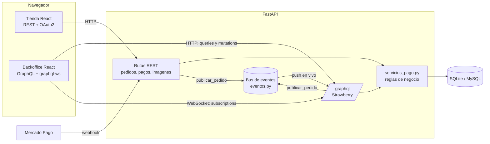

Decisiones de diseño:

- **GraphQL solo para el backoffice**, REST para la tienda. Así no se rompe lo que ya
  funcionaba y GraphQL se usa donde luce: pantallas que piden muchos datos a la vez y datos en vivo.
- **Una sola fuente de reglas de negocio.** REST y GraphQL llaman a las mismas funciones de
  `servicios_pago.py` (`entregar_pedido`, `cancelar_pedido`, `aplicar_estado`). Si se corrige una
  regla, se corrige en los dos lados.
- **Mismo login para todo.** El token JWT de OAuth2 sirve para REST y GraphQL.
- **Strawberry** (code-first, con tipos de Python) se monta como un router más de FastAPI.

## 3. Roles y permisos (OAuth2 scopes)

Se agregó el scope **`trabajador`** a los que ya existían (`pedidos`, `admin`):

| Scope | Quién lo tiene | Permite |
|---|---|---|
| `pedidos` | todos | Comprar y ver *sus* pedidos |
| `trabajador` | trabajadores y admins | Ver todos los pedidos, confirmar recogidas |
| `admin` | solo admins | Productos, categorías, equipo, marcar pagos, estadísticas |

En GraphQL cada campo declara su permiso (`permission_classes=[EsAdmin]`, `EsPersonal`,
`EsUsuario`). Un cliente que intenta `{ pedidos { id } }` recibe *"No tienes permiso"* y un
trabajador que intenta `eliminarProducto` también (hay pruebas automáticas de esto).
Como el navegador **no puede mandar headers en un WebSocket**, el token de las subscriptions
viaja en el mensaje `connection_init` (`connectionParams`).

La sesión del personal dura **12 horas** (la del cliente 30 min), porque el trabajador deja el
panel abierto todo el turno.

## 4. Cambios en la base de datos

| Tabla | Columna nueva | Para qué |
|---|---|---|
| `producto` | `activo` | Ocultar un producto de la tienda sin borrarlo (si ya se vendió, no se puede borrar) |
| `cliente` | `es_trabajador` | Rol de mostrador |
| `pedido` | `codigo_recogida` | Código de 6 caracteres que el cliente muestra para recoger |
| `pedido` | `fecha_entrega`, `entregado_por` | Auditoría: quién y cuándo entregó |

Al arrancar, `database.py` **agrega solas** estas columnas a un `gomitas.db` anterior y les pone
código a los pedidos viejos, así que no hay que borrar la base (probado con una BD de la versión
anterior). `db.sql` quedó actualizado para MySQL/MariaDB.

El código usa un alfabeto sin `0/O/1/I/L` para que nadie los confunda al dictarlo.

## 5. API GraphQL (`/graphql`)

**Queries**

| Query | Rol | Uso |
|---|---|---|
| `productos(busqueda, categoriaId)` | admin | Lista completa (incluye ocultos) |
| `categorias`, `equipo` | admin | Catálogos del backoffice |
| `pedidos(estado, metodo, buscar, soloPorRecoger, limite)` | trabajador | Lista y fila "Por recoger" |
| `pedidoPorCodigo(codigo)` | trabajador | El trabajador teclea el código del cliente |
| `resumen` | trabajador | Números del día (el dinero solo lo ve el admin) |
| `misPedidos` | cliente | Historial propio |

**Mutations**

| Mutation | Rol |
|---|---|
| `crearProducto`, `actualizarProducto`, `ajustarStock`, `cambiarActivo`, `eliminarProducto` | admin |
| `crearCategoria`, `actualizarCategoria`, `eliminarCategoria` | admin |
| `crearTrabajador`, `cambiarEstadoUsuario`, `marcarPagado` | admin |
| `confirmarRecogida(pedidoId, codigo)`, `cancelarPedido(pedidoId)` | trabajador |

**Subscriptions**

```graphql
subscription {
  pedidosEnVivo {            # trabajador: todos los pedidos
    tipo                     # NUEVO | PAGADO | ENTREGADO | CANCELADO | ACTUALIZADO
    pedido { id total codigoRecogida cliente { nombre } pago { metodo estado } }
  }
}
subscription { inventarioEnVivo { tipo productoId producto { nombre stock } } }   # admin
subscription { misPedidosEnVivo { tipo pedido { id estado } } }                   # cliente: solo los suyos
```

Validaciones del lado del servidor (no solo en el formulario): precio y stock no negativos,
nombre y descripción obligatorios, la categoría debe existir, no se puede borrar un producto
que ya está en pedidos ni una categoría con productos, un admin no puede deshabilitarse a sí mismo.

## 6. Cómo funcionan las Subscriptions

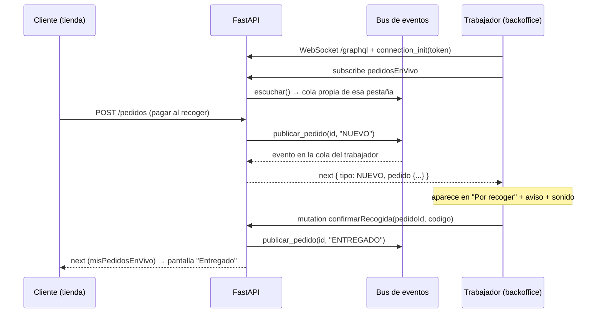

`app/eventos.py` es un bus en memoria: cada subscription abierta tiene su propia `asyncio.Queue`.
Quien cambia algo llama `publicar_pedido()`; como las rutas REST corren en otro hilo que el
WebSocket, se usa `call_soon_threadsafe`. Solo viaja el **id**: la subscription vuelve a leer la
base y manda el pedido fresco. En el frontend, `graphql-ws` **reconecta solo** (1 s, 2 s, 4 s…
máx. 10 s) y al reconectar las pantallas vuelven a pedir sus datos, por si se perdió un evento.
El panel muestra un indicador **"En vivo / Reconectando…"**.

## 7. Flujo de recogida en el mostrador

1. El cliente compra (tarjeta/Mercado Pago, OXXO, link o **pagar al recoger**) y ve su **ticket
   con código** (ej. `K7M2QX`).
2. El pedido aparece **solo** en *Recogida → Por recoger* del trabajador (si ya está pagado, dice
   "Pagado en línea con Mercado Pago, solo entrégalo"; si es pagar al recoger, "cobra $X en caja").
3. El trabajador escribe el código (se busca solo al completar 6 caracteres) o elige el pedido de
   la fila, y confirma en un diálogo. El servidor valida el código.
4. El pedido queda **Entregado** con quién y cuándo. Si era "pagar al recoger", ahí mismo se marca
   el cobro como aprobado.

Regla importante: **un pedido de Mercado Pago que aún no se paga NO se puede entregar** (ficha OXXO
pendiente, tarjeta rechazada...). En cuanto el pago se aprueba, aparece en la fila.

## 8. Imágenes de productos

`POST /imagenes` (solo admin, `multipart/form-data`) guarda el archivo en `back/uploads/` con nombre
aleatorio y FastAPI lo sirve en `/uploads/<archivo>`. Al producto solo se le guarda esa ruta.
Seguridad: se revisa la **firma del archivo** (JPG/PNG/WEBP/GIF), no el nombre ni el `content-type`
(se pueden falsificar), máximo 5 MB y nombre aleatorio (sin `../` ni sobrescribir archivos). En el
formulario se arrastra la foto, se ve la vista previa y una **tarjeta tal como se verá en la tienda**.

## 9. Capturas

**Inicio del admin** — números del día, actividad en vivo y productos por reponer
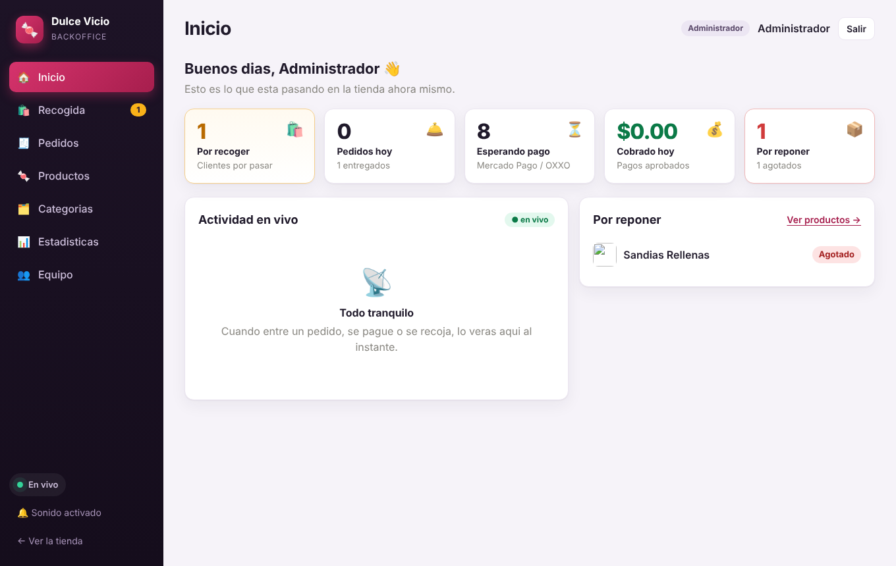

**Productos** — stock con +/−, interruptor "En tienda", editar y eliminar
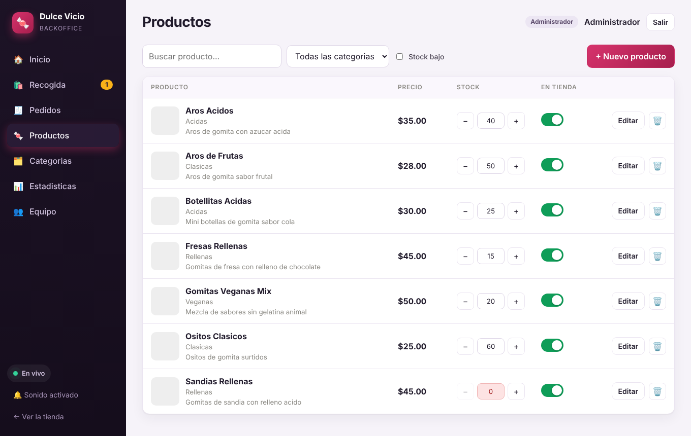

**Nuevo producto** — foto con arrastrar y soltar y vista previa de la tienda
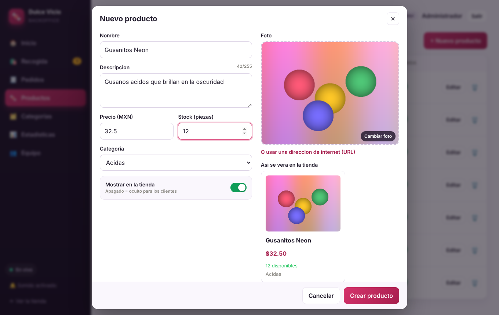

**Ticket del cliente** con su código de recogida
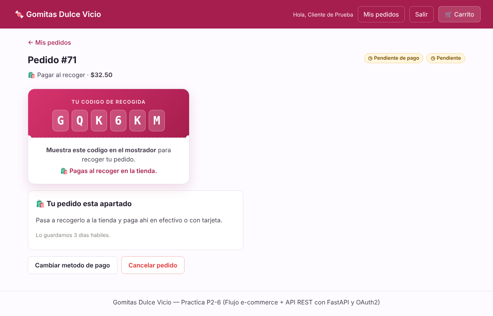

**Recogida (trabajador)** — el pedido llegó solo, con aviso
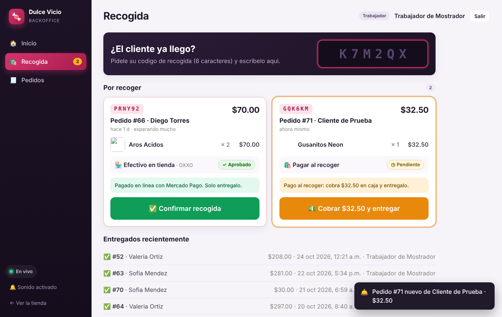

**Buscar por código** y **confirmar entrega**
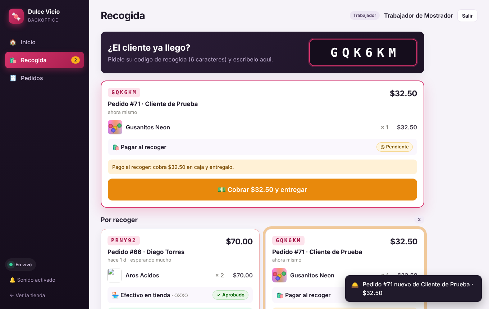
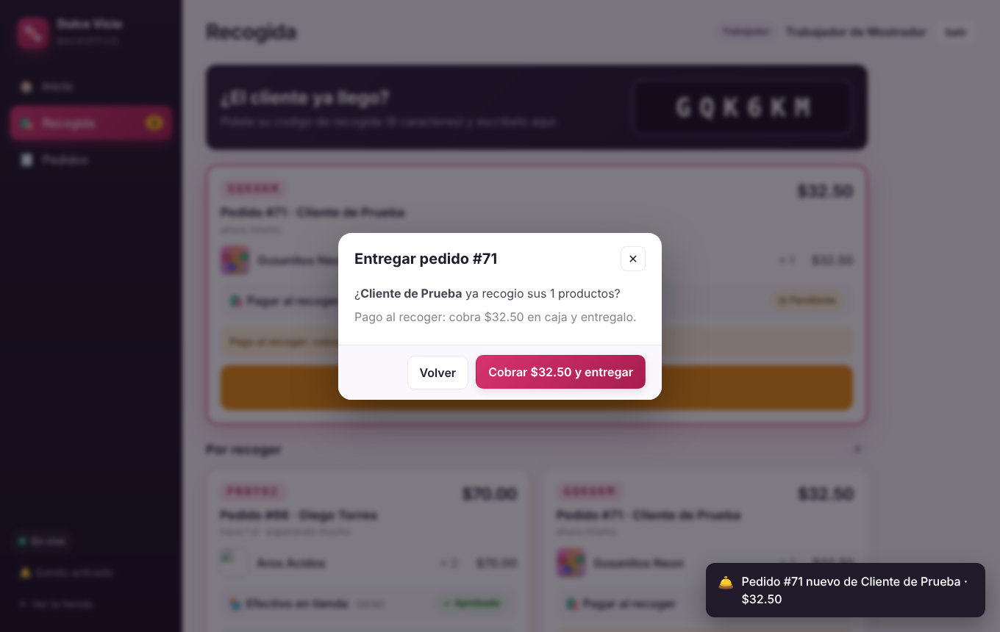

**El cliente ve "Entregado" sin recargar**
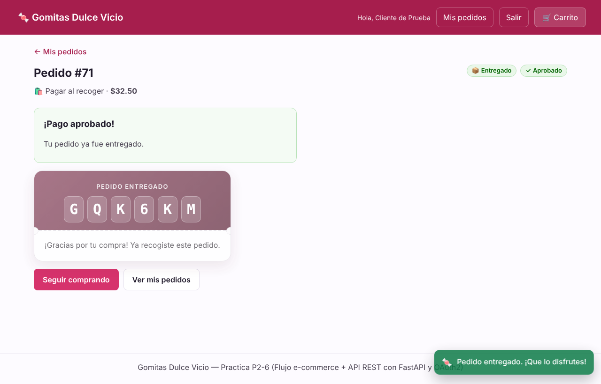

**Pedido pagado con Mercado Pago listo para entregar**
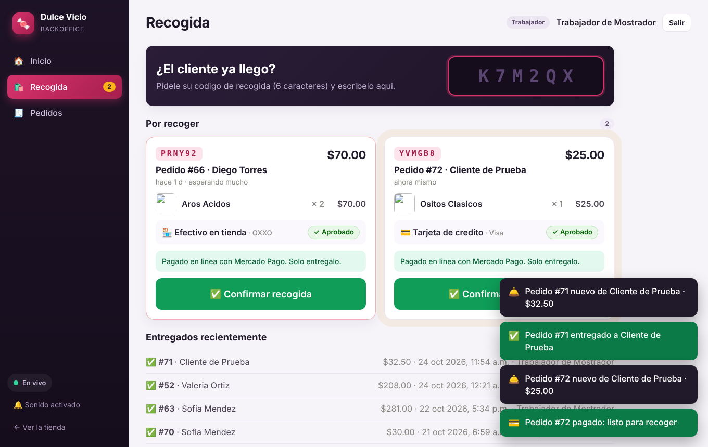

**Pedidos** (admin, filtros y avisos en vivo) y detalle
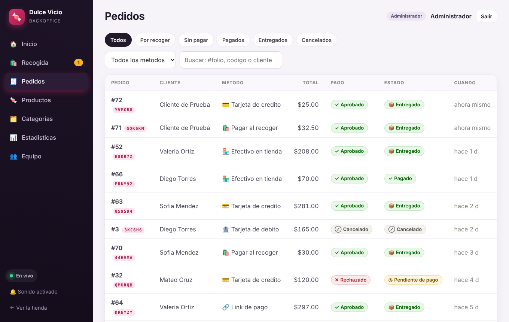
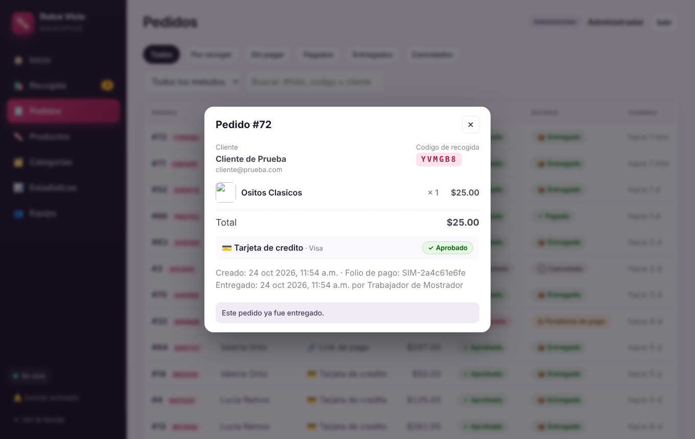

**Equipo**, **Categorías** y **Estadísticas**
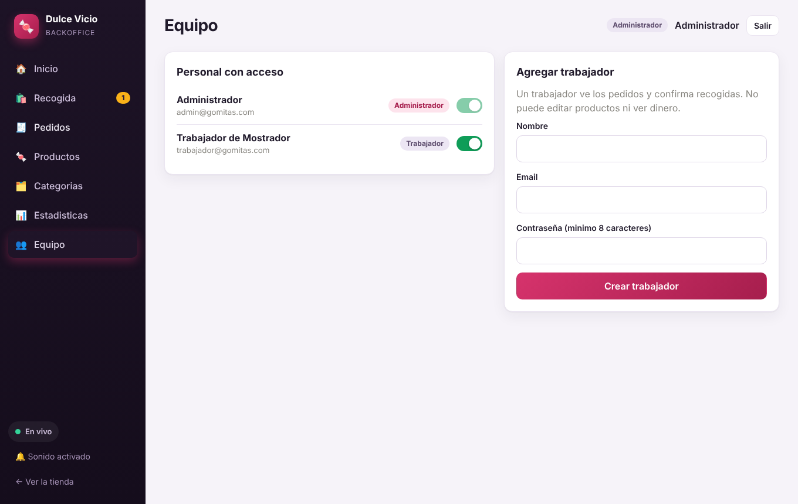
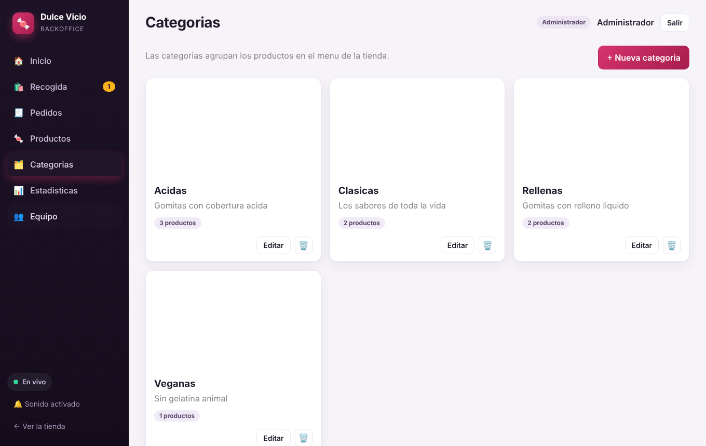
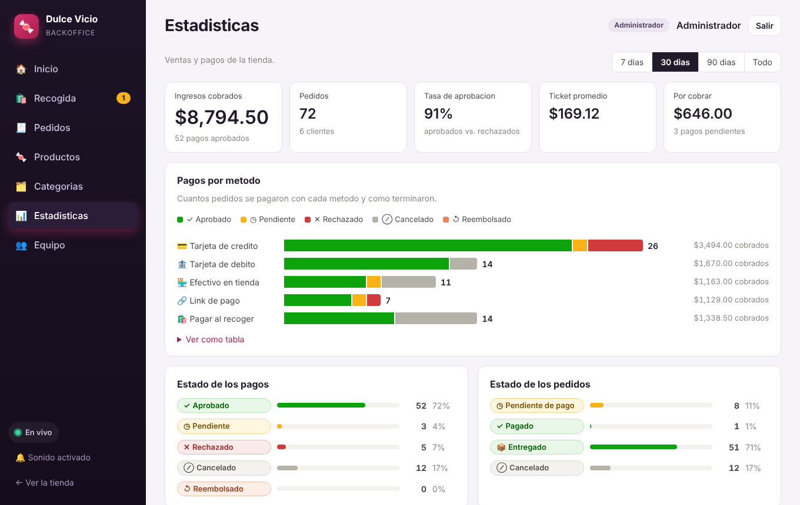

**En celular** (el trabajador puede usar el panel desde su teléfono)

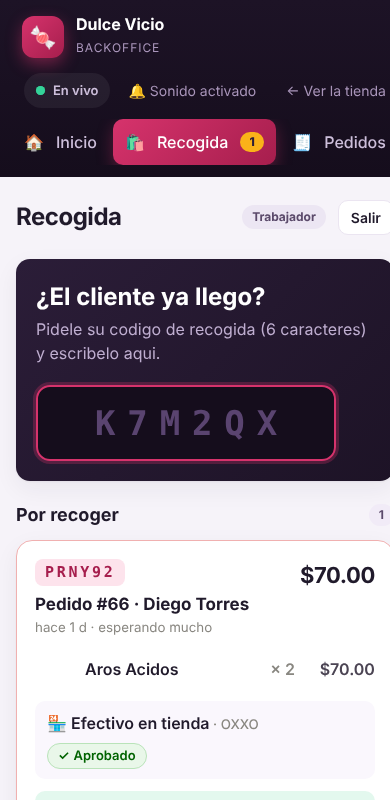

## 10. Pruebas

- **10 pruebas automáticas** (`PROBAR.bat` o `pytest`): las 3 anteriores + 7 nuevas en
  `tests/test_backoffice.py` — permisos de GraphQL por rol, CRUD de productos y categorías,
  validaciones, subida de imágenes (rechaza archivos falsos y de más de 5 MB), ocultar producto,
  confirmación de recogida (código incorrecto, doble entrega, pedido sin pagar), equipo y las
  **3 subscriptions** por WebSocket real (incluye que un cliente solo reciba *sus* pedidos y que
  sin token se rechace).
- **Prueba de punta a punta en navegador real** (Chromium): admin crea un producto con imagen →
  el cliente lo compra → el pedido aparece **sin recargar** en el panel del trabajador → el
  trabajador lo entrega con el código → la pantalla del cliente cambia sola a *Entregado*; y lo
  mismo con un pedido pagado con Mercado Pago (simulado). 17 comprobaciones, sin errores en consola.
- Se probó que una base de datos de la versión anterior **migra sola**.

## 11. Límites y mejoras posibles

- El bus de eventos es **en memoria de un solo proceso**. Para varios servidores habría que usar
  Redis pub/sub. Para una tienda con un mostrador es suficiente.
- Mercado Pago se probó con la **pasarela simulada**; con el *Access Token* de prueba en `.env` usa
  el sandbox real (ver `back/README.md`). Los webhooks necesitan una URL pública (ngrok).
- Las imágenes se guardan en disco local (`back/uploads/`); en producción irían a un servicio de
  almacenamiento (S3, Cloudinary...). Al reemplazar una foto, el archivo viejo no se borra.
- Mejoras: impresión de ticket, historial/auditoría de cambios de productos, reportes exportables.

## 12. Cómo correrlo

```bash
# Windows: doble clic en INICIAR.bat   |   PROBAR.bat para las pruebas
cd back  && pip install -r requirements.txt && cp .env.example .env && fastapi dev app/main.py
cd front && npm install && npm run dev            # http://localhost:5173
```

| Rol | Email | Contraseña |
|---|---|---|
| Administrador | `admin@gomitas.com` | `admin12345` |
| Trabajador | `trabajador@gomitas.com` | `trabajador12345` |
| Cliente | `cliente@prueba.com` | `cliente12345` |

GraphiQL (para probar el API a mano): http://localhost:8000/graphql
