# Reporte P2 — Flujo E-commerce con sesion OAuth2 (Frontend)

## Descripcion general

Frontend en **React + Vite** para el e-commerce de gomitas, ahora conectado a la
**API REST en FastAPI** (antes GraphQL) y con **inicio de sesion OAuth2**. El recorrido
`Home → Categoria → Detalle de producto → Carrito → Login/Registro → Checkout` se sigue
controlando 100% con **estado local (`useState`) y eventos** dentro de `App.jsx` — sin
`react-router` ni URLs. `App.jsx` es una maquina de estados con 5 vistas (`home`,
`categoria`, `carrito`, `login`, `checkout`); el detalle de producto sigue siendo un
**modal** (via portal).

**Checkout es una vista protegida:** el catalogo y el carrito son publicos, pero para
confirmar un pedido se necesita sesion. Si no la hay, `App` muestra `LoginView` y al
entrar regresa automaticamente al checkout.

## Cambios respecto a la version GraphQL

| Antes (GraphQL) | Ahora (REST + OAuth2) |
|---|---|
| `api/client.js` → `graphqlRequest(query, variables)` a un solo endpoint | `api/client.js` → `apiRequest(path, opciones)` + objeto `API` con un metodo por endpoint |
| Hook `useGraphQL(query, variables)` | Hook `useApi(peticion, deps)` (generico, recibe cualquier promesa) |
| Checkout pedia nombre y email en un formulario | El cliente sale del token; checkout muestra "Pedido a nombre de ..." |
| Sin sesion | `useAuthStore` (Zustand + `persist`) guarda `token` y `usuario` |
| 4 vistas | 5 vistas: se agrega `LoginView` (login y registro en una sola vista) |
| `TopBar` solo con carrito | `TopBar` muestra "Hola, {nombre}" + **Salir**, o **Iniciar sesion** |

## Temas de React aplicados (11 de 15 requeridos: minimo 8)

| # | Tema | Donde |
|---|------|-------|
| 1 | Componentes / composicion | `TopBar`, `Sidebar`, `Hero`, `ContextSection`, `Footer`, `ProductCard`, `CategoryCard`, `LoginView` |
| 2 | Hooks (`useState`, `useEffect`, hook propio) | `useApi` (fetch con loading/error/data), `ProductModal` (Esc listener), `App` (vista actual y destino tras login) |
| 3 | Padre → hijos (props) | `App` pasa `categorias`, `usuario`, callbacks y `cart` a las vistas |
| 4/5 | Eventos HTML y eventos custom | `onClick`, `onChange`, `onSubmit` nativos + props `onSeleccionarCategoria`, `onAgregarCarrito`, `onIniciarSesion`, `onCerrarSesion`, `onExito` |
| 6 | Listas y keys | `Sidebar`, grids de `ProductCard`, `CartView` (`key={id}`) |
| 7 | Fragment | `ProductCard` y los campos condicionales de `LoginView` / `TopBar` |
| 8 | Estilizacion (2 formas) | `ContextSection` combina `className` y `style={}` inline |
| 9 | Zustand (estado global) | `useCartStore` (carrito) y `useAuthStore` (sesion), ambos con `persist` → `localStorage` |
| 10 | Skeletons | `Skeleton.jsx` mientras `CategoryView` espera el fetch |
| 11 | Portales | `ProductModal` con `createPortal(..., document.body)`, `Esc` para cerrar, `aria-modal` |

## Arquitectura de componentes (UML)

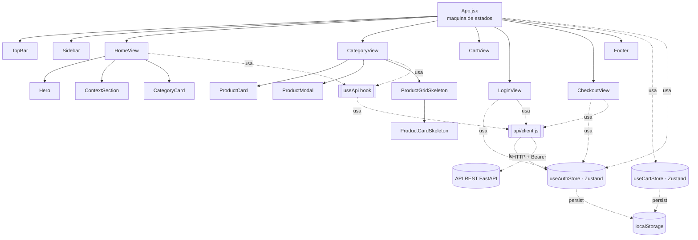

## Maquina de estados de navegacion

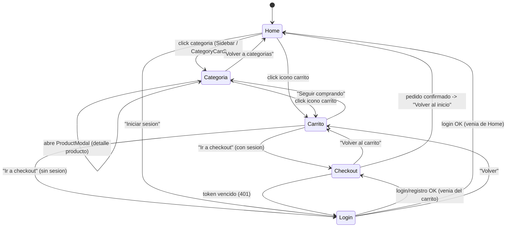

## Flujo de autenticacion en el frontend

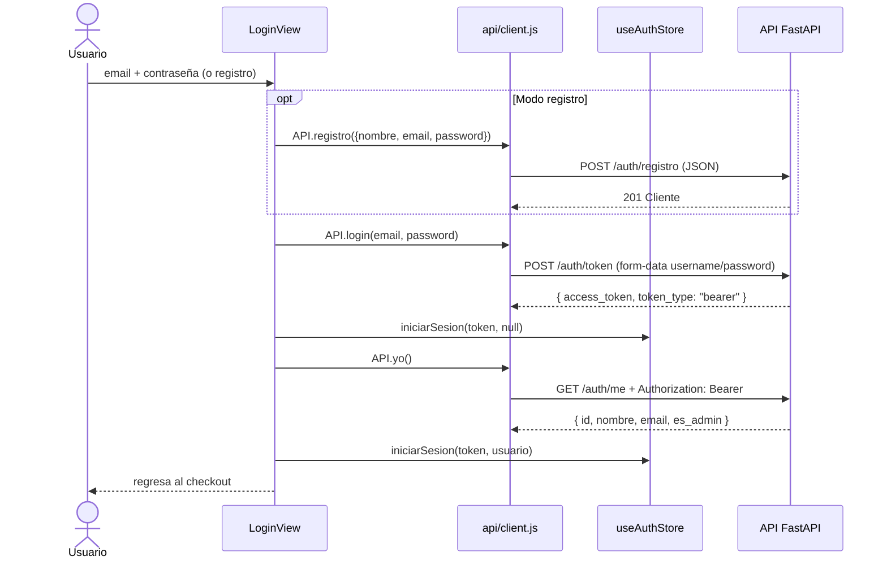

## Flujo de datos

1. `HomeView` y `CategoryView` usan `useApi` para pedir `GET /categorias` y
   `GET /categorias/{id}` (loading/error/data). Estas rutas son publicas.
2. Al agregar un producto desde el modal, `ProductModal` llama a `onAgregar`, que viene
   de `App` → `useCartStore.agregarProducto` (Zustand).
3. `apiRequest` lee el token de `useAuthStore` en cada peticion y, si existe, agrega el
   header `Authorization: Bearer <token>`. El login se manda como **form-data**
   (`URLSearchParams`), que es lo que exige OAuth2; el resto como JSON.
4. `CheckoutView` manda solo los items (`[{ producto_id, cantidad }]`) a
   `POST /pedidos`; el backend sabe quien es el cliente por el token. Si confirma, se
   vacia el carrito y se muestra la confirmacion.
5. Si cualquier respuesta es **401** con un token guardado (vencido o invalido),
   `apiRequest` llama a `cerrarSesion()`; como `App` deriva la vista
   (`checkout` sin usuario → `login`), el usuario vuelve a ver el login sin perder el carrito.
6. Los errores de FastAPI (`{ detail: "..." }` o la lista de errores de validacion) se
   convierten a un mensaje legible y se muestran en la vista.

## Capturas

| | |
|---|---|
| 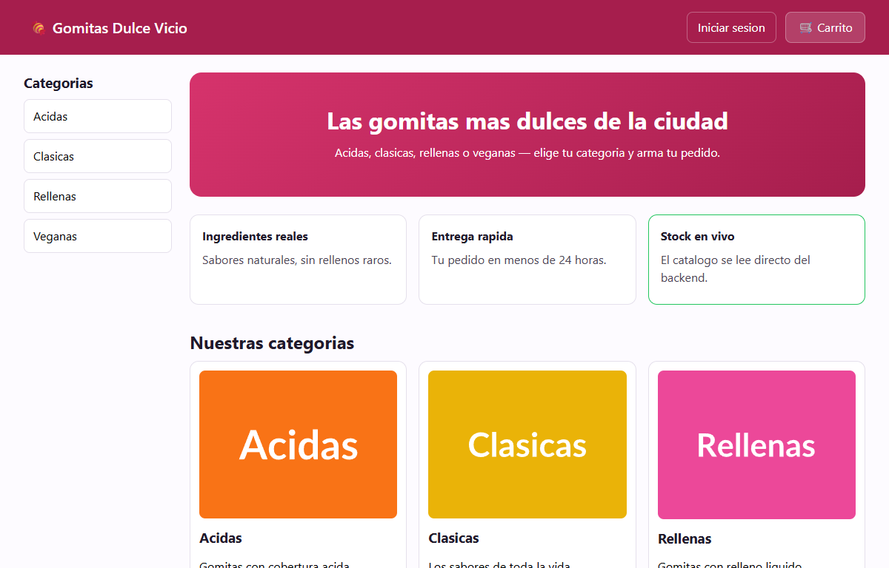 Home: categorias desde `GET /categorias` | 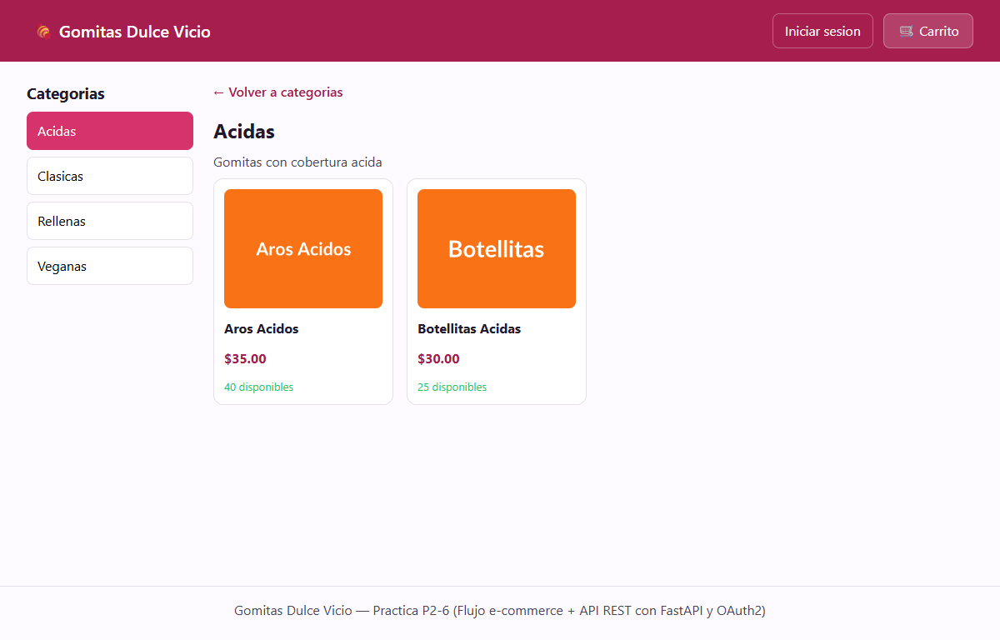 Categoria con sus productos |
| 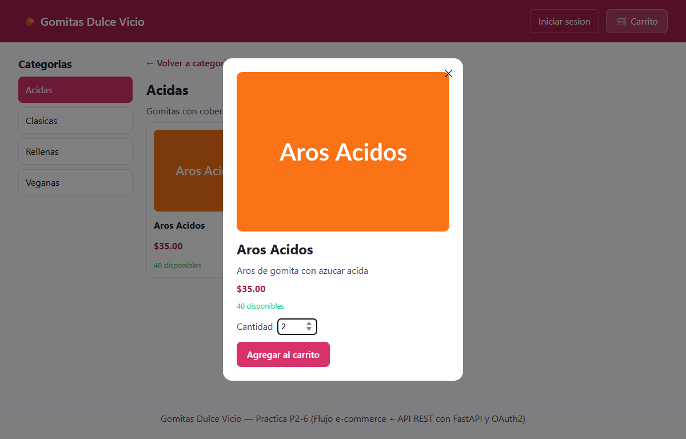 Detalle de producto (portal) | 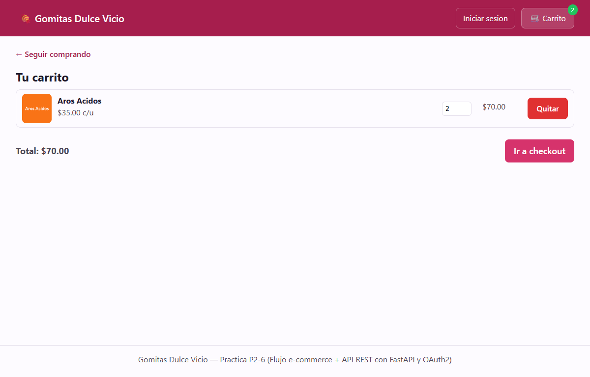 Carrito (Zustand + localStorage) |
| 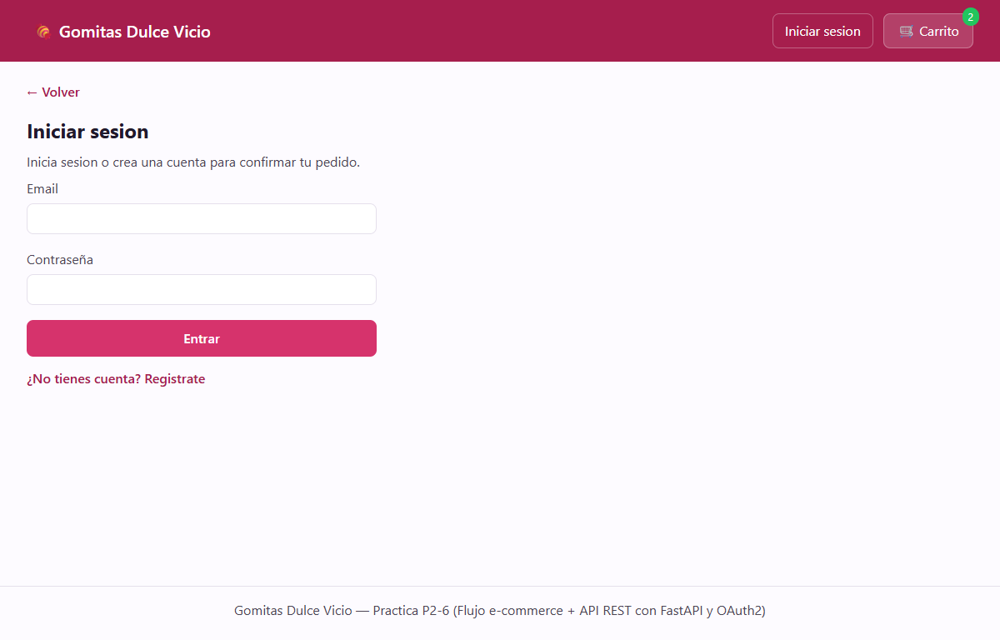 Checkout sin sesion → login | 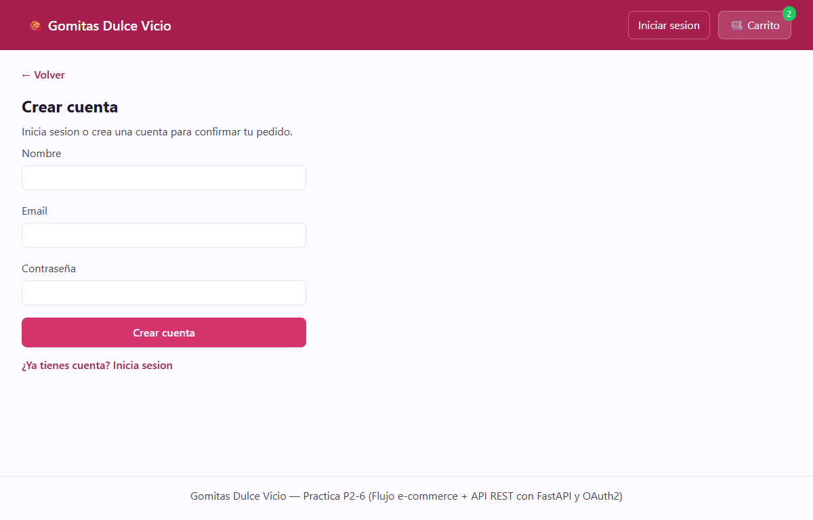 Modo registro |
| 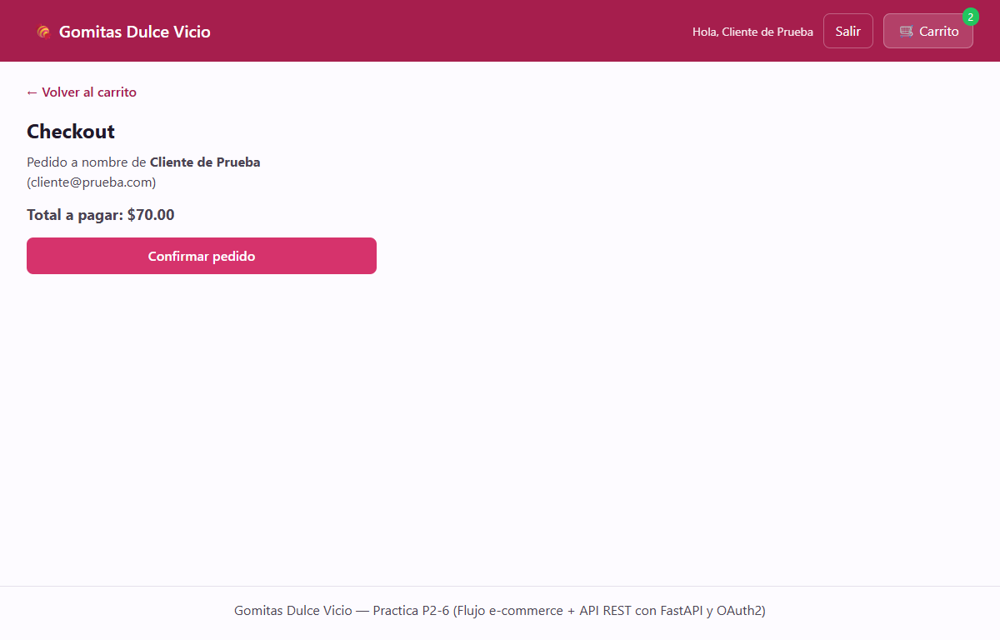 Checkout con sesion: el cliente sale del token | 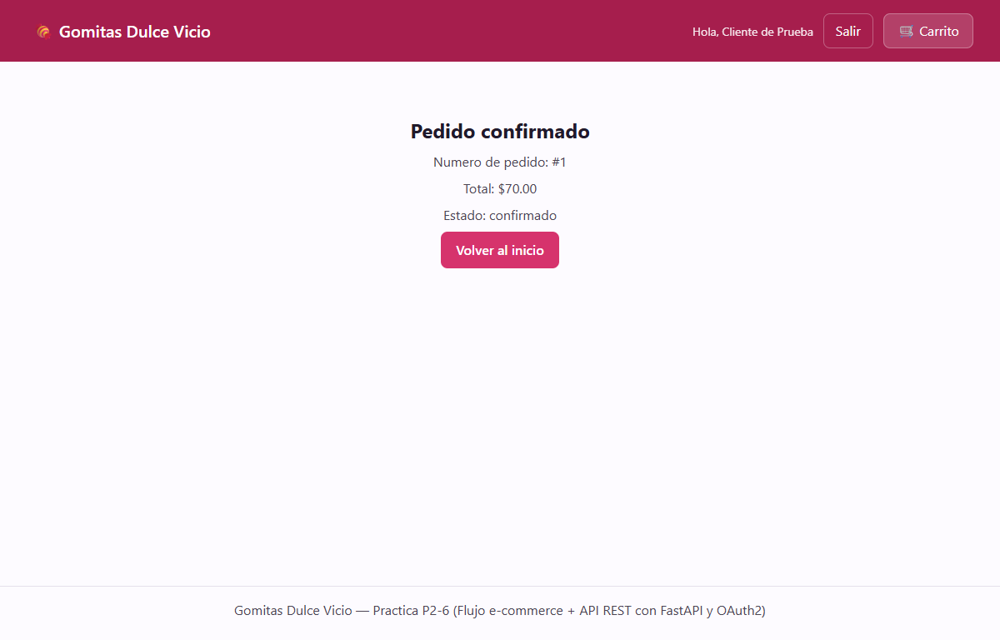 Pedido confirmado por `POST /pedidos` |
