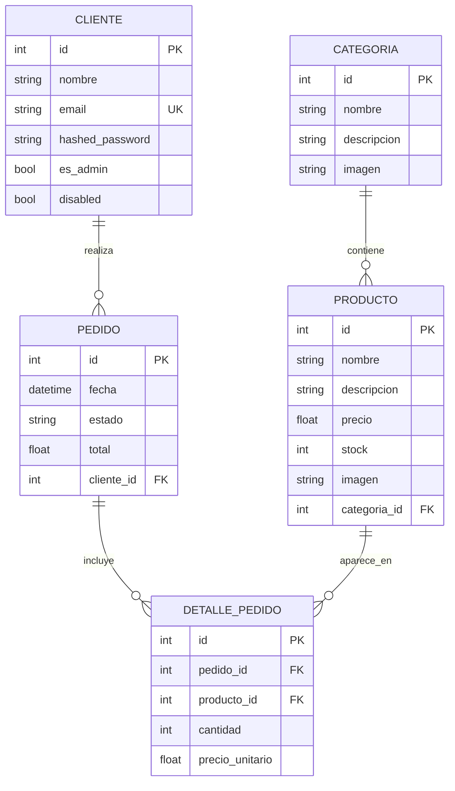
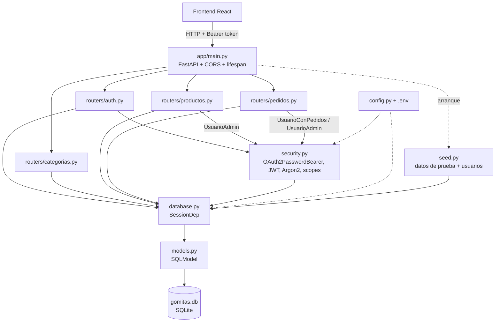
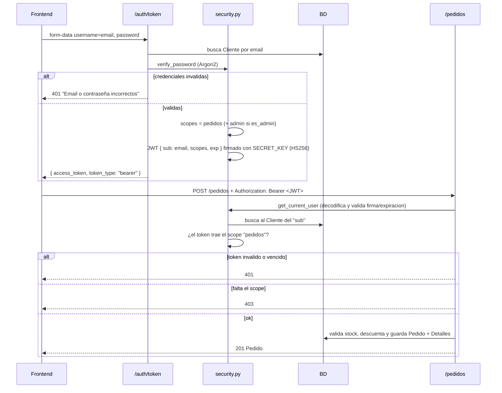
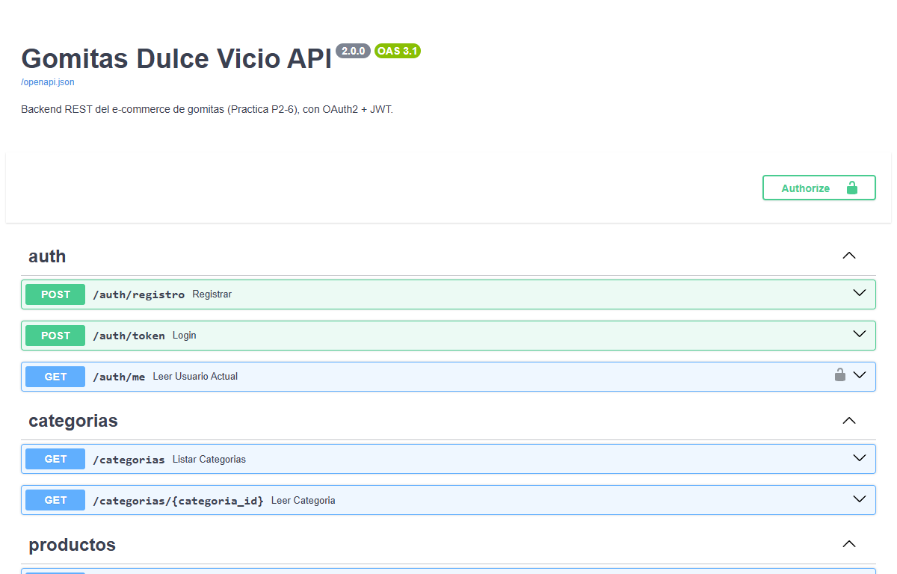
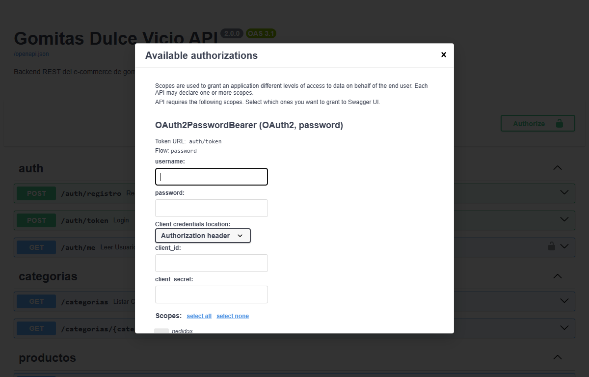

# Reporte P6 — Backend REST con FastAPI y OAuth2

## Descripcion general

Migracion del backend GraphQL (Node.js + Apollo Server 5, datos en memoria) a una
**API REST con FastAPI** (Python), siguiendo el tutorial oficial
(https://fastapi.tiangolo.com/tutorial/). Ademas se agrego **autenticacion OAuth2**
(Password Flow con tokens **JWT**) y **autorizacion por scopes**.

Los datos ya no viven en memoria: se guardan en una base **SQLite** (`back/gomitas.db`)
mediante **SQLModel**, que se crea y se llena con los datos de prueba al arrancar. El
mismo esquema esta en `db.sql` para MySQL/MariaDB; solo se cambia `DATABASE_URL`.

| Capitulo del tutorial | Donde se aplica |
|---|---|
| Bigger Applications – Multiple Files | `app/main.py` + `app/routers/` (un `APIRouter` por recurso) |
| SQL (Relational) Databases (SQLModel) | `app/database.py` (engine, `SessionDep`), `app/models.py` |
| Multiple Models / Models with Relationships | modelos tabla vs. `*Create` / `*Update` / `*Public` |
| Settings and Environment Variables | `app/config.py` (`pydantic-settings`) + `.env` |
| Security – OAuth2 with Password (and hashing), Bearer with JWT | `app/security.py`, `app/routers/auth.py` |
| Advanced Security – OAuth2 scopes | scopes `pedidos` y `admin` |
| CORS (Cross-Origin Resource Sharing) | `CORSMiddleware` en `app/main.py` |
| Lifespan Events | crear tablas + seed al arrancar |
| Testing | `tests/test_api.py` con `TestClient` |

## DER — Entidades y relaciones



**Cambio en el modelo:** `Cliente` ahora tambien es el **usuario** que inicia sesion.
Se agregaron `hashed_password` (hash **Argon2**, nunca texto plano), `es_admin` (define
que scopes puede recibir) y `disabled`. Los IDs pasaron de `ID` (string) a `int`
autoincremental, y los campos a `snake_case` (`categoria_id`, `precio_unitario`).

## Endpoints REST

| Metodo | Ruta | Acceso | Antes en GraphQL |
|---|---|---|---|
| POST | `/auth/registro` | publico | — (nuevo) |
| POST | `/auth/token` | publico (login OAuth2) | — (nuevo) |
| GET | `/auth/me` | autenticado | — (nuevo) |
| GET | `/categorias` | publico | `categorias` |
| GET | `/categorias/{id}` | publico (incluye productos) | `categoria(id)` |
| GET | `/productos?categoria_id=` | publico | `productos(categoriaId)` |
| GET | `/productos/{id}` | publico | `producto(id)` |
| POST | `/productos` | scope `admin` | `crearProducto` |
| PATCH | `/productos/{id}` | scope `admin` | `actualizarProducto` |
| DELETE | `/productos/{id}` | scope `admin` | `eliminarProducto` |
| POST | `/pedidos` | scope `pedidos` | `crearPedido` |
| GET | `/pedidos/mios` | scope `pedidos` | — (nuevo) |
| GET | `/pedidos/{id}` | scope `pedidos` (dueño o admin) | `pedido(id)` |
| GET | `/pedidos` | scope `admin` | `pedidos` |

En GraphQL todo era `POST /` con errores dentro de `200 OK`; en REST cada operacion
tiene su verbo y su codigo HTTP: **201** al crear, **204** al borrar, **400** stock
insuficiente, **401** sin token, **403** sin permiso, **404** no existe, **409**
conflicto (email repetido o producto con pedidos), **422** validacion de datos.

## Arquitectura (UML de componentes)



## Autenticacion: OAuth2 Password Flow + JWT



**Scopes** (permisos dentro del token):

- `pedidos` — cualquier cliente: crear pedidos y ver los suyos.
- `admin` — solo usuarios con `es_admin`: CRUD de productos y ver todos los pedidos.

Las dependencias `UsuarioActual`, `UsuarioConPedidos` y `UsuarioAdmin` (en
`security.py`) se declaran como parametro de cada endpoint con `Security(...)`, asi
la regla de acceso queda visible en la firma de la funcion y en Swagger (candado).

## Medidas de seguridad

- Contraseñas con hash **Argon2** (`pwdlib`), como recomienda el tutorial actual.
- Si el email no existe igual se verifica un hash de relleno, para que la respuesta
  tarde lo mismo y no se pueda averiguar que emails estan registrados.
- El servidor **solo otorga los scopes que el usuario tiene**: aunque un cliente pida
  `scope=admin` al hacer login, su token no lo incluye.
- El token **vence** (`ACCESS_TOKEN_EXPIRE_MINUTES`, 30 por defecto).
- `SECRET_KEY` vive en `.env` (excluido de git), no en el codigo.
- Los modelos `*Public` nunca incluyen `hashed_password`.
- `GET /pedidos/{id}` de otro cliente responde **404** (no 403), para no revelar que
  el pedido existe.
- CORS solo permite el origen del frontend (`http://localhost:5173`).

## Reglas de negocio validadas

- `POST /pedidos` rechaza productos inexistentes o con stock insuficiente (**400**) y
  **no** descuenta stock a medias: todo se guarda en un solo `commit`.
- Si el mismo producto viene dos veces en el pedido, se suman las cantidades antes de
  validar el stock.
- El total y los subtotales se calculan en el servidor con el precio de la BD; no se
  confia en el precio que mande el cliente.
- El pedido se asocia al cliente del token (ya no se manda nombre/email en el cuerpo).
- No se puede borrar un producto que ya aparece en pedidos (**409**), igual que el
  `ON DELETE RESTRICT` de `db.sql`.
- Pydantic valida los datos de entrada: precio y stock no negativos, cantidad > 0,
  email valido, contraseña de 8+ caracteres, al menos un item por pedido (**422**).

## Pruebas realizadas

**Automaticas** — `pytest` (`tests/test_api.py`, BD temporal): **1 prueba de punta a
punta, aprobada**, que cubre:

- Catalogo publico: 4 categorias; categoria 1 con sus 2 productos.
- `POST /pedidos` sin token → 401; login con contraseña incorrecta → 401.
- Registro (201, sin `hashed_password` en la respuesta) y registro repetido → 409.
- Pedido con 2 productos → total 95, subtotal 70, stock descontado.
- Pedido con un producto agotado → 400 y el stock del otro producto **no** cambia.
- Otro cliente no puede ver el pedido ajeno → 404.
- Cliente normal intentando crear producto o listar todos los pedidos → 403, incluso
  pidiendo `scope=admin` en el login.
- Admin: crear (201), editar (200), borrar (204) producto; borrar producto con
  pedidos → 409; ver todos los pedidos.
- Token alterado → 401.

**Manuales** — desde el frontend real y desde Swagger UI (`/docs`): flujo completo
Home → categoria → carrito → login/registro → checkout → `POST /pedidos` → confirmacion.

## Documentacion interactiva

FastAPI genera la documentacion OpenAPI automaticamente. En `http://localhost:8000/docs`
el boton **Authorize** abre el formulario OAuth2 (password flow) con los scopes
disponibles; despues de autenticarse se pueden probar los endpoints protegidos.

| | |
|---|---|
|  Swagger UI con los endpoints por router |  Formulario OAuth2 de Swagger (Token URL `auth/token`, flow `password`, scopes) |

## Como correrlo

```bash
cd back
python -m venv .venv
.venv\Scripts\activate
pip install -r requirements.txt
copy .env.example .env
fastapi dev app/main.py
pytest
```
