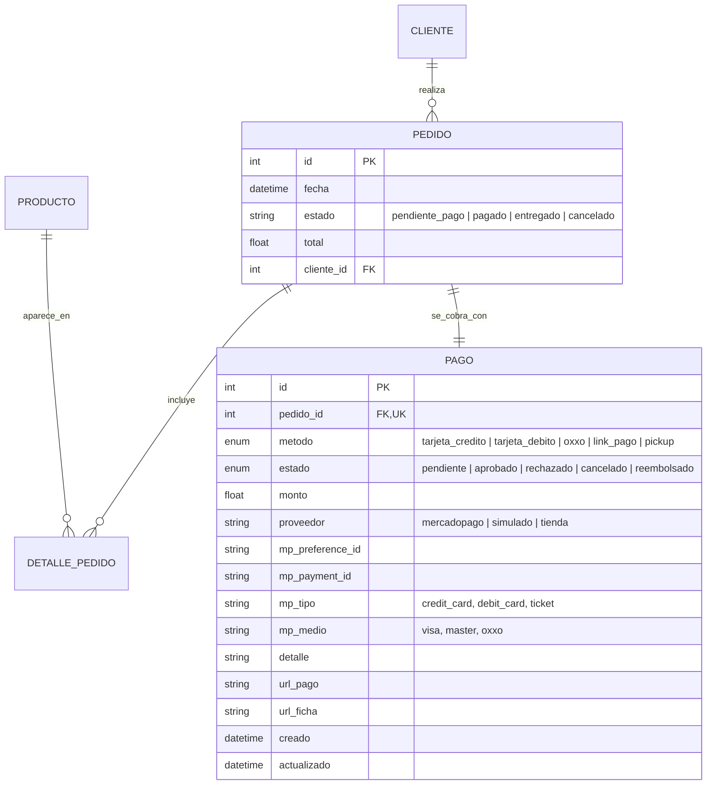
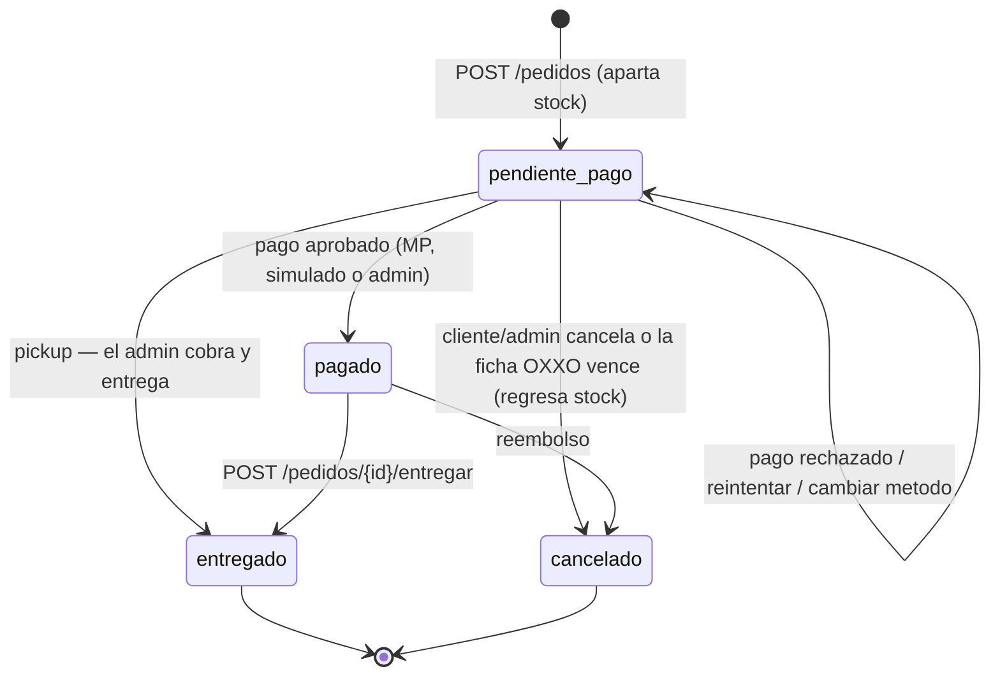
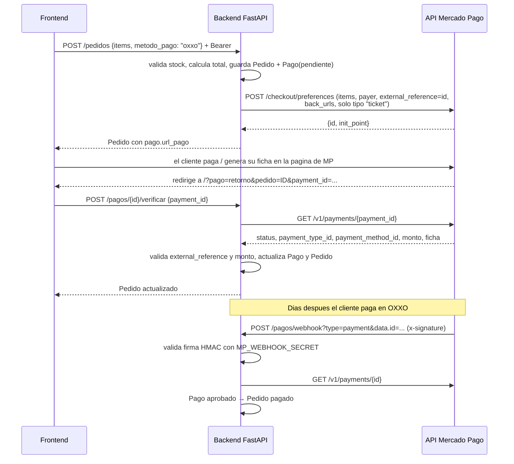
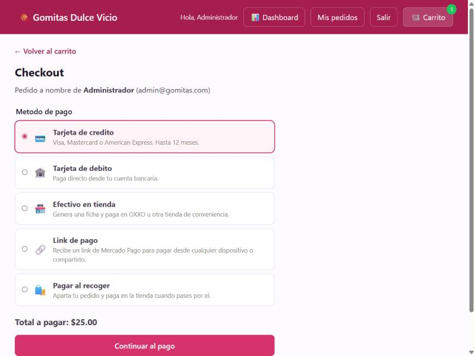
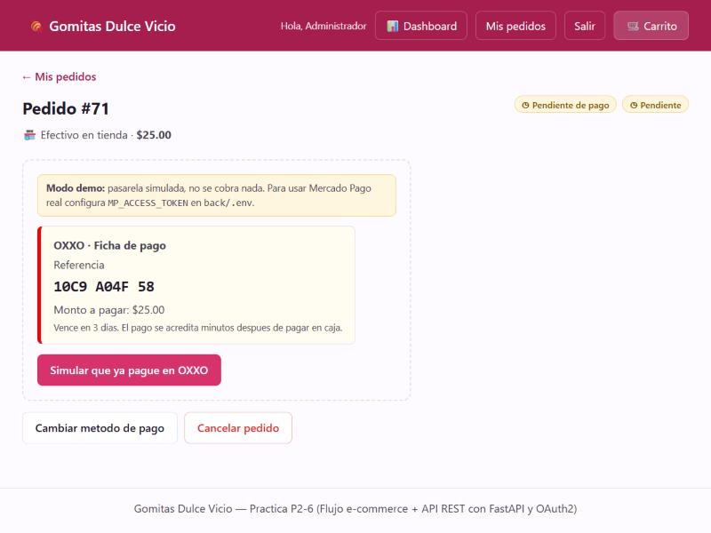
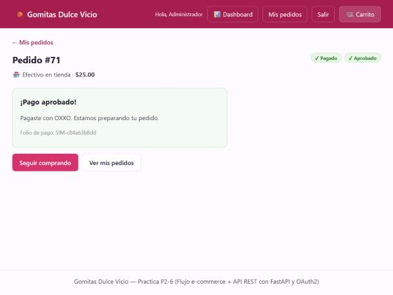
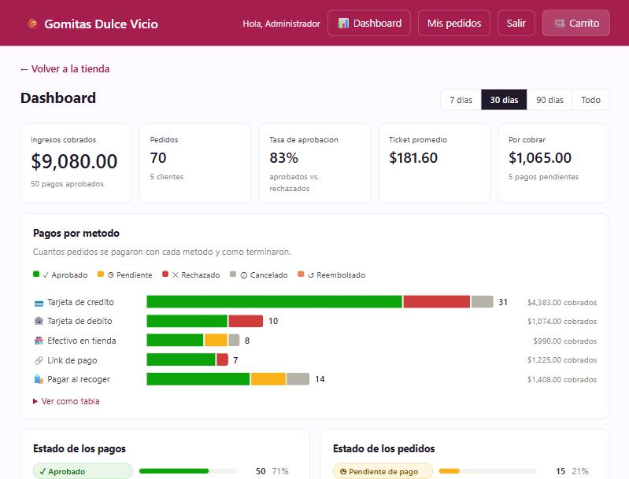
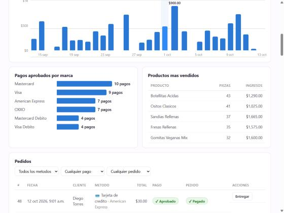

# Reporte — Metodos de pago con Mercado Pago y dashboard de administrador

## Descripcion general

Sobre el backend FastAPI + OAuth2 de la P6 se agrego el **cobro de los pedidos** con
**Mercado Pago Checkout Pro** y un **dashboard** para que el administrador vea las
estadisticas del e-commerce.

- 5 metodos de pago: **tarjeta de credito**, **tarjeta de debito**, **efectivo en
  tienda** (ficha OXXO), **link de pago** y **pagar al recoger** (pickup).
- Integracion con la API REST de Mercado Pago usando `httpx`, sin SDK: preferencias,
  consulta de pagos y **webhook** con firma `x-signature` (HMAC-SHA256).
- **Pasarela simulada** cuando no hay credenciales, para probar todo sin cuenta.
- Vista **Mis pedidos** para el cliente: pagar, reintentar, cambiar de metodo o cancelar.
- **Dashboard** del admin: ingresos, pagos por metodo y estado, tasa de aprobacion,
  marcas de tarjeta, ingresos por dia, productos mas vendidos y la tabla de pedidos
  con acciones.

## DER — nueva entidad Pago

Se separo el **estado del pedido** (logistica) del **estado del pago** (dinero): un
pedido pickup puede estar "pendiente de pago" y despues "entregado", y un pago puede
ser "rechazado" mientras el pedido sigue abierto para reintentar.

## Maquina de estados

## Flujo con Mercado Pago (Checkout Pro)

Para cada metodo, la preferencia **excluye los tipos de pago que no corresponden**
(`payment_methods.excluded_payment_types`), asi Mercado Pago solo muestra lo elegido:

| Metodo de la tienda | Tipo que se deja en MP | Notas |
|---|---|---|
| Tarjeta de credito | `credit_card` | hasta 12 mensualidades |
| Tarjeta de debito | `debit_card` | 1 pago |
| Efectivo en tienda | `ticket` | OXXO y otras tiendas; MP genera la ficha |
| Link de pago | todos | se puede compartir; quien lo abra paga |
| Pagar al recoger | — | no pasa por MP; el admin cobra al entregar |

## Endpoints nuevos

| Metodo | Ruta | Acceso |
|---|---|---|
| POST | `/pedidos` | scope `pedidos` — ahora recibe `metodo_pago` |
| POST | `/pedidos/{id}/cancelar` | dueño o admin — regresa el stock |
| POST | `/pedidos/{id}/entregar` | scope `admin` |
| GET | `/pedidos?metodo=&estado=&estado_pago=` | scope `admin` |
| GET | `/pagos/config` | publico |
| POST | `/pagos/{id}/reintentar` | dueño |
| POST | `/pagos/{id}/verificar` | dueño |
| POST | `/pagos/{id}/simular` | dueño, solo modo simulado |
| PATCH | `/pagos/{id}` | scope `admin` |
| POST | `/pagos/webhook` | publico, con firma |
| GET | `/admin/estadisticas?dias=` | scope `admin` |

## Medidas de seguridad

- **No se confia en el navegador.** La URL de regreso de MP solo dice *que* pago
  revisar; el estado real se pide a la API de Mercado Pago con el Access Token.
- Se valida que el pago de MP sea **del mismo pedido** (`external_reference`) y que el
  **monto pagado** cubra el total; si no, **400**.
- El **webhook** valida `x-signature` con HMAC-SHA256 y `hmac.compare_digest`, y de
  todas formas vuelve a consultar el pago en MP (el cuerpo de la notificacion puede ser
  falso). Siempre responde 200 a notificaciones validas para que MP no reintente.
- `MP_ACCESS_TOKEN` y `MP_WEBHOOK_SECRET` viven en `.env`, nunca en el codigo.
- La pasarela simulada **no pide numeros de tarjeta** y se desactiva sola en cuanto se
  configura Mercado Pago (409 si se intenta usar).
- Un pago que llega despues de cancelar el pedido se registra como "requiere reembolso"
  en vez de reabrir el pedido.

## Dashboard

Todo sale de `GET /admin/estadisticas` (conteos y sumas en SQL con `GROUP BY`):

- **Numeros principales:** ingresos cobrados, pedidos, tasa de aprobacion
  (aprobados / (aprobados + rechazados)), ticket promedio y monto por cobrar.
- **Pagos por metodo:** barras apiladas por estado del pago. Responde "¿cuantos
  pagaron con tarjeta de credito?" y "¿cuantos se aprobaron o rechazaron?". Incluye
  "Ver como tabla".
- **Estado de los pagos** y **estado de los pedidos**, con conteo y porcentaje.
- **Ingresos cobrados por dia** (agrupados en hora de Mexico, UTC-6).
- **Pagos aprobados por marca** (Visa, Mastercard, American Express, OXXO...).
- **Productos mas vendidos** en pedidos pagados.
- **Tabla de pedidos** con filtros y acciones: entregar, cobrar y entregar (pickup),
  marcar pagado y cancelar. Cada accion refresca las estadisticas.

Las graficas son HTML + CSS propios (sin librerias). Los colores de estado (verde
aprobado, amarillo pendiente, rojo rechazado, gris cancelado) **siempre van con icono y
texto**, hay leyenda y tooltip al pasar el mouse o con el teclado.

| | |
|---|---|
|  Selector de metodo de pago |  Ficha OXXO (pasarela simulada) |
|  Pago aprobado |  Dashboard: resumen y pagos por metodo |
|  Ingresos por dia, marcas, productos y pedidos | |

## Pruebas realizadas

**Automaticas** — `pytest`: **3 pruebas, aprobadas** (`tests/test_api.py` y
`tests/test_pagos.py`, con la API de Mercado Pago simulada con `monkeypatch`):

- Metodo de pago invalido → 422.
- Tarjeta rechazada y luego aprobada; un pedido pagado ya no se puede pagar ni cancelar (409).
- Cancelar un pedido sin pagar regresa el stock.
- Reintentar cambiando de tarjeta a pickup; el pickup no pasa por la pasarela.
- El admin entrega un pickup y en ese momento queda cobrado; un pedido con tarjeta sin
  pagar no se puede entregar; el admin puede marcarlo pagado a mano.
- Mercado Pago: ficha OXXO pendiente con su URL → webhook con firma mala (401) → webhook
  valido aprueba el pedido.
- Pago aprobado por un monto menor o de otro pedido → 400.
- Varios intentos (rechazado + aprobado): se queda el aprobado.
- Dashboard: un cliente recibe 403; el admin recibe conteos por metodo y estado, 30 dias
  de ventas y el top de productos.

**Manuales** — en el navegador: compra con efectivo en tienda (generar ficha → simular
pago → aprobado), Mis pedidos, regreso desde Mercado Pago (`?pago=retorno`), dashboard en
escritorio y en celular.
